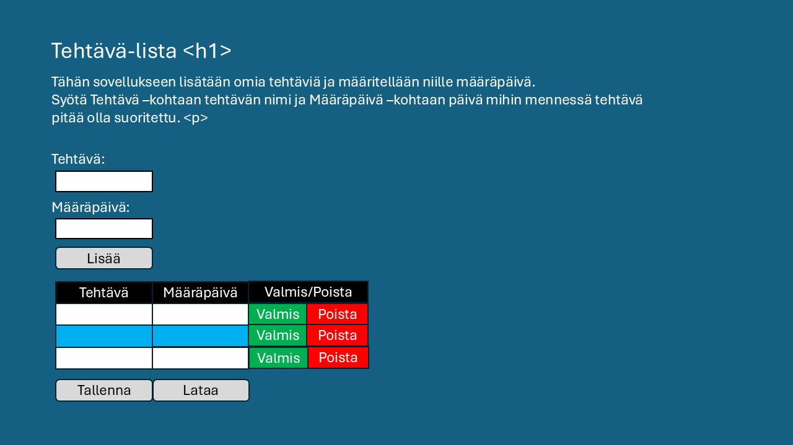
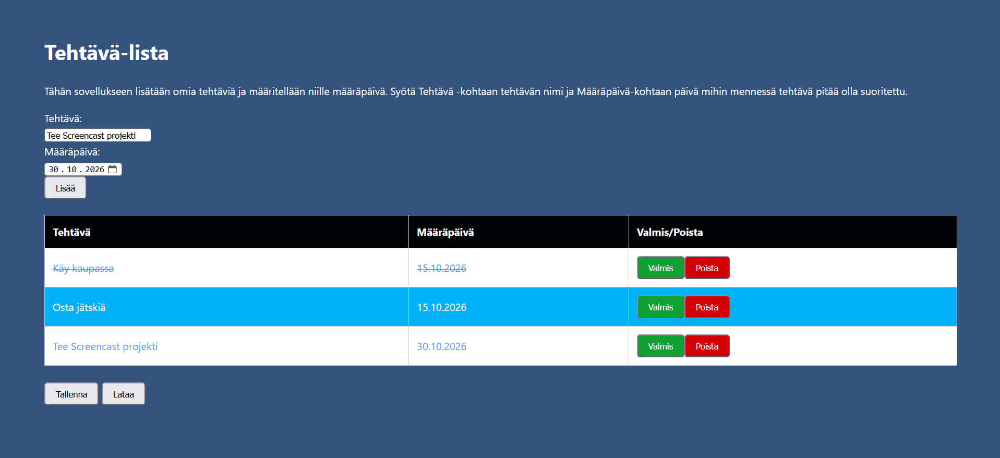

# Projektin nimi

**Tekijä(t):** Juha Korhonen / Jon Mattila

## Projektisuunnitelma

### Projektin idea

Sovellus on tehtävälista ja se on tarkoitettu niille ketkä haluavat listata tehtävänsä.

### Suunnitellut toiminnot

Listaa vähintään kolme sovellukseesi suunniteltua toimintoa:

- Tehtävien lisääminen listaan
- Tehtävien luokitteleminen valmiiksi listassa
- Tehtävien poistaminen listasta
- Tehtävälistan tallentaminen localStorageen

### Rautalankamalli / luonnos

## Verkkolinkit

- **Julkaistu sovellus:** [Lisää tähän GitHub Pages -osoite](https://yourusername.github.io/your-repository/)
- **GitHub-repositorio:** https://https://github.com/Yuhius/Projekti_1_DOM_Skriptaus
- **Projektin videoesittely:** [Lisää tähän videon osoite](https://example.com/)

## Tietoja sovelluksesta

**Tehtävä-lista** on verkkosovellus, joka on tarkoitettu niille kenellä on vaikeuksia muistaa kaikkia tehtäviään. Tehtävä-listaan voi lisätä tehtäviä ja antaa niille määräpäivät mihin mennessä tehtävät pitää olla tehtynä. Listalta voi kuitata tehtäviä tehdyksi ja poistaa niitä tarpeen vaatiessa.

## Teknologiat

Kuvaile, mitä teknologioita käytit ja mikä niiden rooli oli projektissasi.

- HTML – otsikko, muu teksti, listan otsikkorivi ja kaikki napit
- CSS – taustaväri sekä tekstin ja taulukon ulkoasu muokattu
- JavaScript – kaikille napeille tehty toiminnat
- localStorage – käytetään Tehtävä-listan tallentamiseen

## Sovelluksen käyttö

Kirjoita lyhyet käyttöohjeet sovellukselle.

1. Avaa julkaistu sovellus yllä olevasta linkistä.
2. Täytä lomakkeen kentät.
3. Lisää, muokkaa, poista tai merkitse kohteita tehdyiksi.
4. Päivitä sivu ja tarkista, säilyvätkö tiedot selaimessa, jos käytit localStoragea.

## Sovelluksen käynnistäminen paikallisesti

1. Kloonaa tai lataa tämä repositorio omalle koneellesi.
2. Avaa projektikansio.
3. Avaa `index.html` selaimessa.

## Kuvakaappaukset

## Tunnetut virheet / puutteet

Takaisin ladattuja Tehtävä-listan rivejä ei pysty muokkaamaan niille tarkoitetuilla napeilla (Valmis/Poista).

## Työn jakautuminen

Ohjelman toteutuksesta vastasivat Juha Korhonen ja Jon Mattila. Työskentely aloitettiin suunnittelemalla ohjelman rautalankamalli PowerPointilla. Ohjelman koodaus toteutettiin Juhan tietokoneella, ja projektin Git-repositorio sijaitsee Juhan hallinnoimassa ympäristössä.

Molemmat osapuolet osallistuivat aktiivisesti ohjelman kehittämiseen, ja työtehtävät jakautuivat tasaisesti tekijöiden kesken. Yhteistyö sujui hyvin ja ongelmitta koko projektin ajan. Ohjelmaa kehitettiin molempien vapaa-ajalla.

## Oma arvio ja oppimisen reflektointi

Pohdi työtäsi ja oppimisprosessiasi.

- Missä onnistuin?
 - Ohjelma toimii suunnitelman mukaisesti.
- Mikä oli haastavaa?
 - Oppimateriaalin hyödyntäminen ei ollutkaan niin yksinkertaisesti vaan apua jouduttiin etsimään materiaalien ulkopuolelta.
- Mitä parantaisin, jos aikaa olisi enemmän?
 - Visuaalisuutta.
 - Parantaisin toiminnallisuuden yksityiskohtia.
- Mitä opin HTML:stä, CSS:stä, JavaScriptistä ja DOM-skriptauksesta?
 - Opimme että JavaScriptillä voi lisätä asioita tyhjään html-elementtiin (esim. tyhjään p-elementtiin).
 - Huomasimme että jos html-elementti luodaan javascriptillä niin sille pitää luoda oma class että sitä voi muokata CSS:llä.
- Mikä jäi epäselväksi tai mistä haluaisin oppia lisää?
 - localStoragen toimivuutta tarkemmin
- Oma arvio projektista: **10/10 pistettä**

## Lähteet ja kiitokset

- Lopullinen työ on luotu opiskelijoiden omasta toimesta.
- Vikojen korjaamiseen on kysytty neuvoa ChatGPT:ltä. Koodia ei kuitenkaan ole suoraan kopioita ChatGPT:ltä.
- Käytetty hyväksi aikaisempia workshoppeja ja opiskelumateriaalia.
- Font-familyt selvitettiin Google Font Familysta.
- Käytetty ChatGPT:tä kommenttien jäsentelyyn.

  ## Lisenssi

Tämä projekti on lisensoitu MIT-lisenssillä.

Lisätietoa lisenssin lisäämisestä GitHub-projektiin:
https://docs.github.com/en/communities/setting-up-your-project-for-healthy-contributions/adding-a-license-to-a-repository